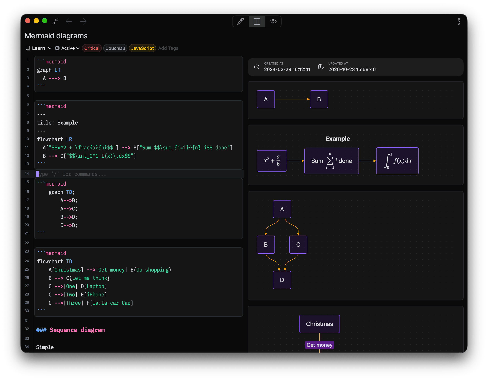

# Mermaid for Inkdrop

Draw flowcharts and diagrams with [Mermaid](https://mermaid.js.org/) syntax in Markdown
code blocks. Diagrams are drawn by [Pele](https://pele.run/), a fast, small engine for
Mermaid syntax, and follow your Inkdrop theme.



This repository holds two things: the Inkdrop plugin, and the host-agnostic rendering
package it is built on.

| Package                                | Published as                                              | What it is                                                                                                                              |
| -------------------------------------- | --------------------------------------------------------- | --------------------------------------------------------------------------------------------------------------------------------------- |
| [`packages/plugin`](packages/plugin)   | `mermaid` (ipm)                                           | The Inkdrop plugin — settings, the full-screen viewer, and the wiring that hands the app's button, theme and print mode to the renderer |
| [`packages/mermaid`](packages/mermaid) | [`@inkdropapp/mermaid`](packages/mermaid/README.md) (npm) | The renderer — themed diagrams, zoom, math and the hover toolbar, as React components that import no Inkdrop API                        |

The split exists because the renderer is useful outside the desktop app: the website demo
and the mobile web editor previously each carried their own port of it. Everything
host-specific arrives as a prop, so one implementation serves all three.

## Using the plugin

```shell
ipm install mermaid
```

See [the plugin README](packages/plugin/README.md) for usage and settings, or
[the Inkdrop docs](https://docs.inkdrop.app/manual/extend-inkdrop-with-plugins) for how
plugins are installed.

## Using the renderer elsewhere

```shell
npm install @inkdropapp/mermaid
```

See [the package README](packages/mermaid/README.md) for the API and the required
stylesheets.

## Development

Requires [pnpm](https://pnpm.io/).

```shell
pnpm install
pnpm build          # builds both packages, in dependency order
pnpm dev            # watch mode
pnpm typecheck
pnpm lint
pnpm format
pnpm --filter @inkdropapp/mermaid check:styles   # add --webkit for the mobile engine
```

`lint` and `format` are configured once at the root ([oxlint](https://oxc.rs/) and
[oxfmt](https://oxc.rs/)) and cover both packages. `check:styles` renders every diagram
type with the real theme tokens in Playwright and fails when a style rule no longer
matches what Pele draws. Run it after bumping `pele`.

To develop against a live Inkdrop, build and symlink the plugin directory:

```shell
pnpm build
ipm link packages/plugin
```

### A couple of things worth knowing

- The plugin **bundles** `@inkdropapp/mermaid` rather than depending on it at runtime. The
  published plugin has to be self-contained: ipm installs it from the registry and its
  tarball excludes `node_modules`.
- `packages/plugin/styles/mermaid.css` is **generated** at build time (copied from the
  renderer package by `scripts/copy-styles.mjs`) and is gitignored. Edit the source in
  `packages/mermaid/styles/`. The plugin's own `styles/fullscreen.css` is hand-written.
- Diagram code is loaded lazily. Pele and the renderer (about 700 kB) live in their own
  chunk, fetched once a diagram appears, and KaTeX (about 260 kB) in another, fetched only
  when a diagram contains `$$` math. Re-check the chunk sizes after touching imports or
  the build config: a chunk group also takes everything its modules import.

## Publishing

Two independent artifacts, and order matters — publish the renderer first if a plugin
release depends on renderer changes, since the plugin bundles it at build time.

```shell
pnpm --filter @inkdropapp/mermaid publish   # npm
ipm publish packages/plugin                 # Inkdrop plugin registry
```

## License

MIT
